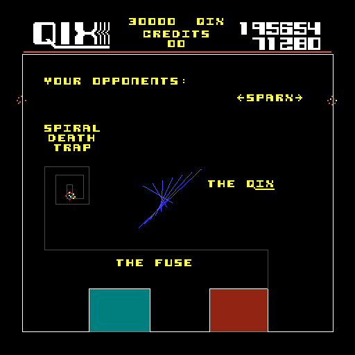
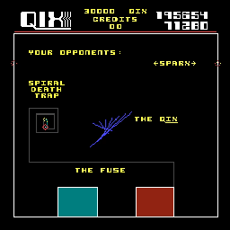
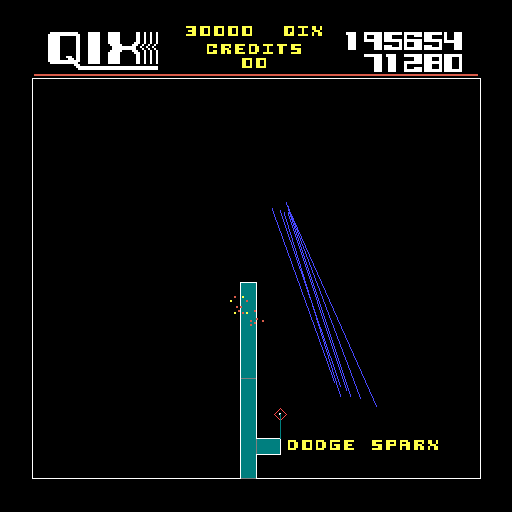
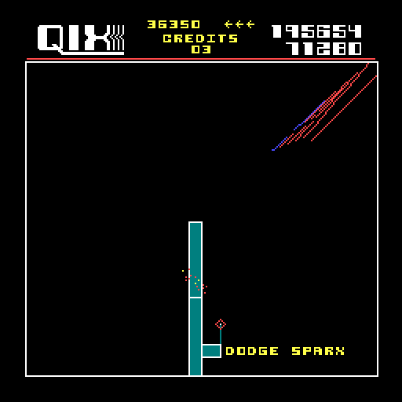

# pyqix
A faithful remake of the 1981 Taito Game Qix for the 40th anniversary on 18th October 2021

Updated for the 45th anniversary on 18th October 2026

## Install and run
  You need Python 3 and pygame 2 (tested with Python 3.10 and pygame 2.6.1):

    pip install -r requirements.txt
    python pyqix.py

  Start it from the repository folder, the game loads its files from `data/`.

## Controls 
  The standard MAME keyset is used:
  
 "5", "6" throw in 1 / 2 credits
 
 "1", "2" start one or two player game
 
 "CTRL" is FAST button
 
 "ALT"  is SLOW button
 
 Cursor keys are Joystick

The complete source code and a ten-part tutorial were released on Qix's 40th Birthday on 18. October 2021

Tutorial:
https://github.com/YogaSurfTech/pyqix/wiki

## Screenshots
Here are some screenshots:
pyqix (native 512x512)|arcade (scaled up to 512x512)
-----|------
 |
 |
